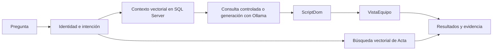

# SynerGy RAG Inventario

Asistente local para consultar activos informáticos y recuperar texto de actas mediante lenguaje natural. Integra **.NET 10**, **Ollama**, validación sintáctica de T-SQL y búsqueda vectorial exacta en **SQL Server 2025**.

**Entrega consolidada:** 30/10/2026. **Corte de evidencias:** 29/10/2026. El PDF académico está en [output/pdf/Avance_Consolidado_SynerGy_RAG.pdf](output/pdf/Avance_Consolidado_SynerGy_RAG.pdf).

## Problema y solución

Las consultas de disponibilidad, asignación y estado requieren conocimiento del modelo de datos. Las actas contienen texto histórico que debe recuperarse sin confundirlo con el inventario actual. La aplicación ofrece una pantalla común, verifica identidades mediante un directorio autorizado y muestra los resultados y su evidencia.

El sistema tiene tres rutas identificables en `metodoGeneracion`:

| Ruta | Funcionamiento | Procedencia |
|---|---|---|
| Consultas habituales | Reglas verificadas de laptops/mouses, SQL controlado y consulta de VistaEquipo | `consulta_validada` |
| Preguntas generales | Embedding de la pregunta, recuperación de contexto, prompt, LLM, ScriptDom y SQL | `modelo_local` |
| Búsqueda de actas | Filtros de tipo/persona y distancia coseno sobre el texto indexado de Acta | `busqueda_vectorial_actas` |

Las aclaraciones no invocan al generador. Un top-K de actas no es un total exacto de documentos ni demuestra una asignación vigente. Cada kit teclado-mouse cuenta como un mouse, según el criterio de negocio confirmado. Los cargadores y soportes no se cuentan como laptops.



## Demostración inmediata de la interfaz

Con Python 3.12, sin SQL ni Ollama:

```powershell
python scripts/demo_visual.py --puerto 5226
```

Abrir [http://127.0.0.1:5226](http://127.0.0.1:5226). La pantalla identifica **DEMO SINTÉTICA** y los tiempos como simulados. Sirve para revisar la experiencia; no es evidencia de ejecución del modelo ni del buscador vectorial.

## Requisitos para el prototipo completo

| Componente | Versión registrada |
|---|---|
| .NET SDK | 10.0.401, con avance al último parche de la misma banda |
| SQL Server | 2025, versión 17.x, con tipo VECTOR y VECTOR_DISTANCE |
| Ollama | 0.40.13 en la instalación comprobada |
| Generador | qwen2.5-coder:7b |
| Embeddings | nomic-embed-text, 768 dimensiones |
| SqlClient / ScriptDom | 7.1.1 / 161.8901.0 |
| PKCS | 10.0.13, actualización correctiva de seguridad |
| Python para informes | 3.12 y requirements.txt |

Los modelos son **preentrenados**. El proyecto no entrena ni ajusta sus pesos: adapta el contexto, las reglas y el prompt y valida el artefacto. Los identificadores de los modelos, el hardware y los parámetros se registran en [entorno.json](resultados/consolidacion/entorno.json). Los pesos se descargan con Ollama; no se incluyen en Git.

Se comprobó ejecución en CPU. Las preguntas que requieren el LLM pueden tardar más de un minuto; los tiempos de consultas controladas no se deben atribuir a una aceleración del modelo. La API utiliza un timeout de 300 segundos.

## Ejecución paso a paso

### 1. Obtener código y paquetes

```powershell
git clone https://github.com/Wilixs102/SynerGy-Rag-Inventario.git
cd SynerGy-Rag-Inventario
dotnet restore SynerGy-Rag-Inventario.slnx --locked-mode
dotnet build SynerGy-Rag-Inventario.slnx -c Release --no-restore
```

Los archivos packages.lock.json fijan las dependencias. GitHub Actions compila y ejecuta pruebas sin acceder a datos privados.

### 2. Iniciar Ollama y descargar modelos

En una terminal, si el servicio no está iniciado:

```powershell
ollama serve
```

En otra terminal:

```powershell
ollama pull qwen2.5-coder:7b
ollama pull nomic-embed-text
ollama list
```

Para una réplica experimental, contrastar los digests con entorno.json. Si cambian los pesos del modelo de embeddings, crear una nueva versión del índice y reindexar; no mezclar espacios vectoriales.

### 3. Preparar una base autorizada

Hay dos opciones:

- **Demostración completa:** crear una base vacía `SynerGyRagDemo` en SQL Server 2025 y ejecutar [esquema_y_datos.sql](data/demo/esquema_y_datos.sql). Incluye 500 activos, 12 custodios y 24 actas ficticias. El inicializador se detiene si el nombre de la base no contiene Demo.
- **Entorno empresarial:** disponer de lectura autorizada de VistaEquipo, de NombreCompleto y CorreoInstitucional de VistaColaboradorInv y de Acta y TipoActa. No se distribuyen volcados empresariales.

En la base auxiliar, ejecutar [crear_contexto_vectorial.sql](docs/sql/crear_contexto_vectorial.sql). La API necesita SELECT en el catálogo; el proceso de indexación usa una credencial independiente con SELECT, INSERT y DELETE en esa tabla. En la base ficticia se puede alojar también el catálogo auxiliar.

Ejemplo con autenticación de Windows y una base demo ya creada:

```powershell
sqlcmd -S ".\INSTANCIA" -d SynerGyRagDemo -E -C -b -i data/demo/esquema_y_datos.sql
sqlcmd -S ".\INSTANCIA" -d SynerGyRagDemo -E -C -b -i docs/sql/crear_contexto_vectorial.sql
```

La opción -C es para certificados del entorno de prueba. Configurar certificados confiables en un despliegue institucional.

### 4. Configurar secretos locales

Sustituir los marcadores por cadenas autorizadas. No escribir credenciales en appsettings.json, commits o capturas.

```powershell
dotnet user-secrets set --project SynerGy-Rag-Inventario "ConnectionStrings:ActivosInformaticos" "<cadena de lectura de la fuente>"
dotnet user-secrets set --project SynerGy-Rag-Inventario "ConnectionStrings:ContextoVectorial" "<cadena de lectura del catálogo auxiliar>"
dotnet user-secrets set --project SynerGy-Rag-Inventario "ConnectionStrings:ContextoVectorialIndexacion" "<cadena del indexador auxiliar>"
```

Para una base demo local con Windows, una cadena de ejemplo es `Server=.\INSTANCIA;Database=SynerGyRagDemo;Integrated Security=True;Encrypt=True;TrustServerCertificate=True;`. En producción usar un gestor de secretos o variables de entorno; la API no debe recibir la credencial de indexación.

### 5. Indexar y habilitar

```powershell
dotnet run --project SynerGy-Rag-Inventario --launch-profile http -- --indexar-catalogo
dotnet run --project SynerGy-Rag-Inventario --launch-profile http -- --indexar-actas
dotnet user-secrets set --project SynerGy-Rag-Inventario "BusquedaVectorial:Habilitada" "true"
dotnet user-secrets set --project SynerGy-Rag-Inventario "BusquedaVectorial:ActasHabilitadas" "true"
```

Las versiones iniciales son inventario-v2 y actas-v1. La indexación es explícita y transaccional; no se realiza por un endpoint público ni durante cada arranque. Modificar texto/versión requiere volver a indexar. El índice de actas usa texto sin HTML e identificadores conocidos enmascarados; revisar el tratamiento de texto libre antes de ampliar el corpus.

### 6. Ejecutar y consultar

```powershell
dotnet run --project SynerGy-Rag-Inventario --launch-profile http
```

Abrir [http://localhost:5225](http://localhost:5225). Ejemplos:

- `Dame el total de las laptops`.
- `¿Cuántos mouses hay?`.
- `Lista las 5 laptops disponibles`.
- `Muéstrame los equipos asignados a Ana Demo` en la base ficticia.
- `Busca actas sobre la responsabilidad de custodia y cuidado de equipos`.

La API admite `POST /api/preguntas` con `{"pregunta":"Dame el total de las laptops"}`. `GET /api/diagnostico/sql` comprueba conectividad. Las listas indican cuando se muestran solo 100 registros. Ante nombres ambiguos se solicita selección; no se inventan correos.

## Validación y métricas

```powershell
dotnet test SynerGy-Rag-Inventario.slnx -c Release --logger "trx;LogFileName=consolidacion.trx" --results-directory .local/test-results
```

La entrega registra **95 pruebas automáticas superadas**, incluidas 30 cargas SQL adversariales. Es una cobertura declarada de escenarios; no una garantía universal de seguridad. Los JSON de [resultados/consolidacion](resultados/consolidacion) resumen pruebas, entorno e integración sin guardar identidades ni resultados operacionales.

Para comprobar la API y contrastar los conteos con SQL de referencia, en Windows con sqlcmd y la conexión local configurada:

```powershell
pwsh -File scripts/recopilar-evidencias.ps1 -ApiUrl http://localhost:5225
# En la base ficticia:
pwsh -File scripts/recopilar-evidencias.ps1 -ApiUrl http://localhost:5225 -Perfil Demo
```

Estos ocho casos funcionales no estiman exactitud global ni sustituyen la evaluación con usuarios. La demo visual se rechaza como fuente de evidencias de integración.

### Evaluación histórica y regresión del generador

| Evidencia | Tamaño | Interpretación |
|---|---|---|
| Histórico | 30 preguntas, 3 configuraciones, 3 repeticiones = 270 generaciones | Proxy por patrones del SQL; 55,6%, 93,3% y 96,7% |
| Regresión actual | 3 preguntas del desarrollo, 3 configuraciones, 1 repetición = 9 generaciones | Comprobación pequeña del generador; no conjunto independiente |
| Integración actual | 8 escenarios seleccionados | Funcionamiento y contraste de conteos; no exactitud global |

En el histórico, `sql_valida` significa aceptación por el validador original; no demuestra sintaxis T-SQL correcta. El histórico se conserva con correos ficticios; los indicadores y tiempos originales no se alteraron. La regresión actual admite COLLATE en los patrones para reconocer consultas equivalentes. Ver los JSON de procedencia y las limitaciones del PDF.

Para repetir la generación histórica con las reglas actuales (los nuevos resultados no serán el histórico original):

```powershell
dotnet run --project tests/SynerGy.RAG.Evaluacion -- --reps 3 --salida resultados/nueva_evaluacion/resultados.csv
python -m pip install -r requirements.txt
python scripts/analizar_resultados.py resultados/nueva_evaluacion/resultados.csv
```

La configuración `vectorial` requiere la cadena lectora mediante `ConnectionStrings__ContextoVectorial`; no utiliza los secretos del proyecto API. Las instrucciones están en [busqueda-vectorial.md](docs/busqueda-vectorial.md). El harness genera y valida SQL, pero no lo ejecuta sobre activos. Para repetir solo la regresión pequeña, añadir `--max 3 --reps 1` y una salida nueva.

## Organización

```text
SynerGy-Rag-Inventario/          API y pantalla web
SynerGy.RAG.Application/         Interfaces, DTOs y casos de uso
SynerGy.RAG.Infrastructure/      SQL, Ollama, vectores y seguridad
SynerGy.RAG.Domain/              Proyecto reservado para evolución del dominio
data/                           Catálogo semántico y datos ficticios
scripts/                        Evaluación, análisis, demo e informe
notebooks/                      Guía del análisis ejecutable en scripts
tests/                          Pruebas automatizadas y harness del generador
resultados/                     Datos históricos y evidencias consolidadas
docs/                           Guías técnicas, matriz de entrega y anexos
output/pdf/                     Avance del documento final en PDF
.github/workflows/              Compilación y pruebas de CI
```

## Documento y anexos

- [Avance del documento final](output/pdf/Avance_Consolidado_SynerGy_RAG.pdf).
- [Matriz de requisitos de la entrega](docs/matriz-entrega.md).
- [Guía de consultas y actas](docs/inventario-y-actas.md).
- [Interfaz y capturas para anexos](docs/interfaz-consultas.md).
- [Informe estadístico histórico](docs/informe.pdf), conservado como anexo previo, no como resultado de la versión consolidada.
- [Resumen histórico](resultados/resumen.md) y [evidencias consolidadas](resultados/consolidacion).

Para generar el PDF desde sus fuentes y evidencias: `python scripts/generar_avance_tesis.py`. Se necesita requirements.txt y una fuente Arial instalada; el generador utiliza Helvetica si no encuentra Arial.

## Límites y seguridad

El prototipo está orientado a pruebas locales autorizadas. **No incorpora autenticación corporativa ni autorización por usuario.** No publicarlo como servicio accesible a terceros con datos reales. ScriptDom limita las fuentes y funciones, pero los permisos SQL y la supervisión siguen siendo necesarios. El enmascaramiento de la interfaz es visual y no sustituye controles de acceso ni anonimiza la API.

No se midieron aún una evaluación ciega de 120 preguntas, relevancia/Recall@K de actas, pruebas de usuarios ni reducción del tiempo del proceso humano. No se declara cumplido el objetivo global de exactitud ni el p95 de ocho segundos en todas las rutas. Ver [SECURITY.md](SECURITY.md), la [bitácora](CHANGELOG.md) y el PDF para los pendientes.
